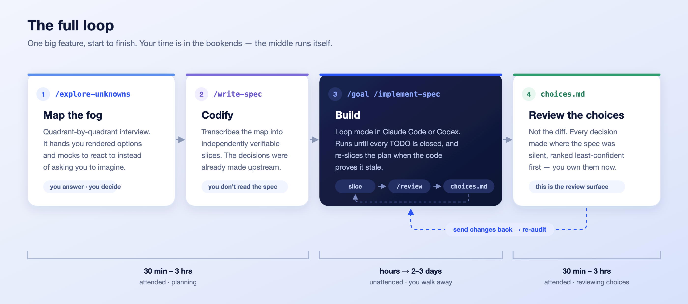

# Skills（技能库）

[](https://skills.sh/dzhng/skills)


> [!IMPORTANT]
> 本仓库是 [dzhng/skills](https://github.com/dzhng/skills) 的**非官方中文汉化版**，供中文用户阅读与学习。技能正文已翻译为中文；技能名（frontmatter 的 `name`）、命令、路径、脚本与代码保持英文原文。内容以上游仓库为准，汉化时间：2026 年 10 月。原版 README 可在上游查看。

**构建"软件工厂"的 AI 技能。** 这是我个人沉淀的、与业务领域无关的智能体技能库，在所有项目中复用。小而组合、可随手改造——支持任何支持技能机制的宿主环境：Claude Code、Codex、opencode、Cursor、[duet](https://duet.so) 以及 [70 多种其他工具](https://github.com/vercel-labs/skills)。

```bash
npx skills add dzhng/skills
```

加 `--list` 可以挑选单个技能，或者把任意 `skills/<category>/<name>/` 文件夹复制进你宿主环境的技能目录（例如 `.claude/skills/`）。

如果是克隆仓库，`npm run install-skills` 可以不走注册表完成同样的事：

```bash
npm run install-skills              # 安装到 ~/.agents/skills，并从 ~/.claude/skills 链接过去
npm run install-skills -- ../my-app # 安装到某个仓库而不是用户主目录
npm run install-skills -- --only write-spec,review ../my-app
npm run list-skills                 # 列出技能名与分类
```

`.agents/skills/<name>/` 存放真实文件（扁平结构、不分分类，跨分类链接会自动改写以匹配）；`.claude/skills/<name>` 是指向它的相对符号链接，两个宿主读的是同一份。重复运行会覆盖已安装的副本——如果你把 `.claude/skills/<name>` 换成了真实目录，它不会被碰；如果 `.claude/skills` 本身已经是符号链接，也保持原样。加 `--dry-run` 可以先看执行计划。

## 为什么

软件正在从"任务"走向"**工厂**"：智能体自主地朝一个目标推进，直到产出可信为止。难点不在于把目标拆成任务——而在于拆成**可以独立验证的部分**，并且知道这些部分到底在哪。

这套技能跑的就是这个循环。把未知当作**战争迷雾**：先画地图，把地盘切成能独立构建、独立验证的领地，再递归地重新切分藏有更多未知的地方。而且重新规划不会随着规划完成而停止——规格说明是一份活的文档，只要实现过程发现计划过时，就随时更新、随时重切。每一部分都必须自证——通过架构评审、代码评审、以及对照基线的视觉评审——循环才会前进。每一次迭代都*更接近正确*，直到目标完成。


> 证据：一次无人值守的 Codex 运行，在这套技能之上朝同一个目标连续推进了 **3 天 18 分钟**，不断切片、迭代直到完成。

## 怎么用

用串联的流水线做一个功能，用研究循环找出什么方案有效，或者按需单独使用技能。每个技能都可以独立使用。

### 完整闭环 —— 一个大功能，从头到尾



1. **绘制迷雾。** 对想法运行 `/explore-unknowns`。它会按象限逐个采访你，递给你渲染好的选项、设计稿和决策表让你做出反应，而不是让你凭空想象。结束时你已经知道这个功能要做什么。

2. **编码成文。** 对这份地图运行 `/write-spec`。大部分决定在上一步已经定了，所以这一步近乎誊写——我不用读规格说明。遇到真正的新问题，它会来问你，而不是自己拍板。

3. **构建。** 启动循环：

   ```
   /goal /implement-spec specs/<feature>
   ```

   `/goal` 是让宿主进入循环模式的那一步——Claude Code 和 Codex 里是同一个动作——接下来就由规格说明接管。小功能几个小时，大功能两三天。可以加任何你需要的限定语：`on the xyz branch`，或者 `using /codex as the implementer while you stay the parent orchestrator and reviewer`。

4. **评审它做的决定，而不是 diff。** 运行结束时会汇总 `specs/<feature>/choices.md`——智能体在规格说明没写到的地方做出的每一个决定，按信心从低到高排序。这就是你的评审面。把修改意见发回去，下一轮会重新审计：AI 每写一次代码，你审的是它"选了什么"。

   其余环节自动触发：每个切片结束时跑一次 `/review`，视觉相关的内容跑 `/screenshot-critique` 和 `/compare-screenshots`，最后一个切片落地时跑 `/close-spec`，实现证明计划过时就重新切片。

时间预算：第 1–2 步 30 分钟到几个小时，第 4 步 30 分钟到几个小时。一个跑两天的任务，两端各花 2–3 小时。你的时间在首尾，中间无人值守。

### 研究循环 —— 用快速实验学习

当下一个决策需要实验证据时，用[自动研究（Auto Research）](skills/engineering/auto-research/SKILL.md)。它从一个快速、有启发性的任务开始，先测一小批假设，再检查组合，随方法改进逐步扩大覆盖。新的失败成为关注点，早期的任务变成回归检查。

```
/auto-research Reduce cost per task by at least 15% relative to the saved
baseline, without reducing task success. Start with one fast development task.
```

如果评测器、指标、基线或目标提升幅度不明确，技能会先问清楚再实验。通过评测与达到提升目标是两个独立要求。输出包括验证过的最优产物和一张**参数-效果地图**：测了什么、在哪里有帮助或有害、改动之间如何互相影响。研究成熟后，用这些证据去支撑一份规格说明。

### 单点即用 —— 即兴路径

- **头脑风暴聊成了功能。** `/explore-unknowns` 既可以用在讨论开头，也可以用在结尾——跑一遍，把你们俩都没想到的角度扫出来，然后从完整闭环的第 2 步接上。

- **任何不是来自规格说明的代码改动。** 一次改动超出预期的临时修复：先 `/review`（refactor-clean → code-review → write-docs），再 `/audit-choices`。当 diff 大到读不完时，决策台账就是你理解代码库现状的方式。

## 技能列表

### 工程 —— 切片、构建、验证、循环

| 技能 | 作用 |
|---|---|
| [explore-unknowns](skills/engineering/explore-unknowns/SKILL.md) | 带用户按象限逐个梳理任务的未知项——先已知之已知，再采访、可反应的产物、盲区排查——最终产出完整的四象限地图。 |
| [auto-research](skills/engineering/auto-research/SKILL.md) | 通过快速、渐进的实验进行优化，产出验证过的候选方案，以及参数效果与权衡的地图。 |
| [write-spec](skills/engineering/write-spec/SKILL.md) | 把大功能拆成可独立验证、人类可评审的切片，带 API 接缝和可玩检查点。 |
| [implement-spec](skills/engineering/implement-spec/SKILL.md) | 把既有规格说明做到完成，每次一轮可评审的实现，独立切片并行委派。 |
| [implement-spec-with-goal](skills/engineering/implement-spec-with-goal/SKILL.md) | 先用宿主的 goal 功能，再按 implement-spec 推进到完成。 |
| [implement-spec-with-codex](skills/engineering/implement-spec-with-codex/SKILL.md) | 由 Codex 写代码来跑 implement-spec——你负责编排、集成和评审每一轮。 |
| [close-spec](skills/engineering/close-spec/SKILL.md) | 归档已交付的规格说明，把它从构建计划改写成指向代码的长期决策依据记录。 |
| [handoff-spec](skills/engineering/handoff-spec/SKILL.md) | 把实现到一半的规格说明交给另一台机器或智能体：把会话已知信息写进规格说明，再推送。用户手动调用。 |
| [refactor-clean](skills/engineering/refactor-clean/SKILL.md) | 重构的方式是把职责迁移到一个干净的概念上，而不是在问题旁边堆积兼容性沉积层。 |
| [write-tests](skills/engineering/write-tests/SKILL.md) | 一次写一条曳光弹测试，钉住真实行为——而不是实现细节、配置值或碰巧成立的样本。 |
| [audit-tests](skills/engineering/audit-tests/SKILL.md) | 把契约映射到独立的测试证据上，合并冗余覆盖，在不丢回归保护的前提下去掉只为测试而生的机器。 |
| [audit-performance](skills/engineering/audit-performance/SKILL.md) | 找出原地空转或重复放大、没有进展的热点路径，按真实失败风险排序，优先做保留自愈能力的最小有界修复。 |
| [write-docs](skills/engineering/write-docs/SKILL.md) | 把文档写成原则与指引的词汇表，而不是注定腐烂的代码镜像。 |
| [code-review](skills/engineering/code-review/SKILL.md) | 审查一个 diff 里的过时命名、死引用、多余复杂度，以及"叙述式"而非"解释式"的注释——最后给出 clean / not-clean 结论。 |
| [audit-choices](skills/engineering/audit-choices/SKILL.md) | 审计实现者做的"决定"而不是它的 diff——纯审计、永不阻塞，用台账披露替用户做出的架构与决策，评审台账而不是代码。 |
| [retro](skills/engineering/retro/SKILL.md) | 主持一次编码会话复盘，对智能体的环境、检查、指引和信息获取提出改进建议。用户手动调用。 |
| [eli5](skills/engineering/eli5/SKILL.md) | 用平实的语言解释规格说明或改动而不丢精度——其他技能借用的 ELI5 文体，用于可独立阅读、走完具体场景的解释。 |
| [review](skills/engineering/review/SKILL.md) | 把一个完成的改动一次性收尾——refactor-clean → code-review → write-docs——串成单一结论。 |
| [codex](skills/engineering/codex/SKILL.md) | 把本地 Codex CLI 当作独立的第二智能体，用于评审，以及在明确要求时代写实现。 |
| [claude](skills/engineering/claude/SKILL.md) | 把 Claude Code（`claude -p`）当作独立的第二智能体，用于咨询，以及在明确要求时代写实现。 |
| [marketing-pages](skills/engineering/marketing-pages/SKILL.md) | 按页面类型编写、更新与审计营销页面的规则手册——活动落地页保持 noindex、不建内链、只有一个 CTA；其余页面都要挣得自己的站点地图条目、爬虫导航链接和唯一文案来源。 |

### 视觉评审 —— 绝不凭感觉接受视觉结果

| 技能 | 作用 |
|---|---|
| [design-with-images](skills/visual/design-with-images/SKILL.md) | 探索生成的视觉方案，固定选中的目标，然后拿真实截图与之迭代，直到实现与设计一致。 |
| [compare-screenshots](skills/visual/compare-screenshots/SKILL.md) | 把截图与通过评审的设计或预期结果对比；用遥测数据定位差异，而不是把历史基线当作正确答案。附带一个可复用的 diff 脚本，也能对单张截图检测内容发白、空页或取景错误。 |
| [screenshot-critique](skills/visual/screenshot-critique/SKILL.md) | 在接受视觉工作之前，用一个没有上下文的子智能体当第二双眼睛；在宣告某个视觉 bug 已修复之前强制执行。 |
| [preview-shots](skills/visual/preview-shots/SKILL.md) | 在一个 macOS 预览窗口里打开一组精选截图，供用户过目。 |

### 技能创作 —— 让技能本身保持锋利

| 技能 | 作用 |
|---|---|
| [write-skills](skills/authoring/write-skills/SKILL.md) | 创建或修订智能体技能：触发条件、引导用语、渐进式披露，以及要剪掉的失败模式。 |
| [audit-agents](skills/authoring/audit-agents/SKILL.md) | 审计或重写 AGENTS.md，让它只保留长期成立的原则，并把迭代速度放在核心位置。附带一份与本技能包配套的示例 AGENTS.md。 |
| [eval-skills](skills/authoring/eval-skills/SKILL.md) | 用黄金用例评测技能——在全新子智能体中盲跑、独立的评审员，以及按缺口驱动的修订。 |

### 图形

| 技能 | 作用 |
|---|---|
| [renderer](skills/graphics/renderer/SKILL.md) | 用 TypeGPU/WebGPU 做 GPU 渲染的架构规则——单一帧编排器、唯一属主、资源注册表、深度与合成契约，以及"看像素"的验证方式。 |
| [launch-video](skills/graphics/launch-video/SKILL.md) | 用代码执导一支发布级的宣传视频——一个从项目本身生长出来的视觉概念，画面与合成配乐锁定到同一时间源，还要有一张能在社交信息流里站得住的预览帧。 |

## 许可证

MIT

## 致谢

感谢 [Matt Pocock](https://x.com/mattpocockuk) 的 [retro 技能](https://github.com/mattpocock/skills/tree/main/skills/engineering/retro)，此处复制时已把其中的写作指南引用指向本仓库的 `write-skills`。也感谢 Matt 与 [Thariq](https://x.com/trq212) 提出的 **战争迷雾** 与 **发现地图** 概念，它们塑造了这套技能。

---

*本中文文档为非官方汉化，如与[英文原版](https://github.com/dzhng/skills)有出入，以上游为准。*
